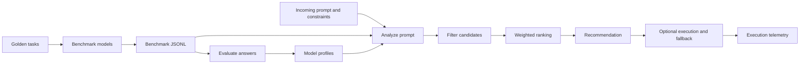

# AI FinOps

**Intelligent LLM model selection and cost optimization**

AI FinOps compares language models, evaluates them on a shared benchmark, and routes
requests using quality, estimated cost, latency, reliability, and context requirements.
The project provides a FastAPI service and a Gradio demonstration for an HCLTech
internship prototype.

For a guided explanation of the problem, every component, the design choices, and
an example routing decision, start with the project walkthrough.
[Project walkthrough](docs/project_walkthrough.md)

## Features

- A common interface for native Ollama and LiteLLM providers.
- Concurrent model comparison with incremental Gradio results and execution telemetry.
- A responsive Gradio layout with wrapped result tables, rendered Markdown answers,
  and a typing reveal after each provider response completes.
- Eleven comparison presets and 22 routing presets covering task types, both routing
  bases, policy tradeoffs, output budgets, evidence fallback, and strict constraints.
- Six configured active models across Ollama, Gemini, and Groq.
- Sixteen reference-answer tasks covering summarization, classification, extraction,
  and reasoning.
- Persistent model/task profiles with quality, median/p95 latency, estimated cost,
  reliability, sample counts, and evaluation provenance.
- Prompt-aware routing with automatic English task detection, lexical benchmark
  matching, request cost/context estimates, and candidate rejection reasons.
- Four weighted policies, custom API weights, and a historical task-average mode.
- Optional execution through the selected model with one eligible fallback.
- Repeatable provider checks, UI workflow checks, and fixed-model KPI replay.

## How it works



A recommendation uses local measurements and pre-execution estimates. Enabling
execution sends the prompt to the selected provider. The response exposes the
historical profile, request estimate, supporting evidence, and selection reasons.

## Quick start

### 1. Install

Python 3.11 or later is required. Run these commands from a terminal.

```bash
git clone https://github.com/GauravBarwa/ai-finops.git
cd ai-finops
python3 -m venv .venv
source .venv/bin/activate
python -m pip install -e '.[dev]'
[ -f .env ] || cp .env.example .env
```

On Windows, create the environment with `py -m venv .venv` and activate it with
`.venv\Scripts\Activate.ps1` in PowerShell. Copy `.env.example` only when `.env`
is absent.

Configure the providers you intend to use in `.env`. Gemini and Groq keys are
optional for a local-only workflow. The model registry lists the exact provider
identifiers used by the adapters. See the provider and environment configuration
instructions. [Configuration](docs/configuration.md)

### 2. Start the API

```bash
uvicorn app.main:app --host 127.0.0.1 --port 8000
```

Open <http://127.0.0.1:8000/docs> for Swagger UI. The health endpoint confirms
application and registry initialization.

```bash
curl http://127.0.0.1:8000/health
```

### 3. Collect measurements and create profiles

A fresh clone contains the benchmark tasks and model configuration. Generated
measurements and profiles belong to each local environment and are gitignored.
Smart Router needs measured profiles before it can recommend a model.

For a local Ollama setup, install the model and start the Ollama service using your
platform's installation procedure.

```bash
ollama pull llama3.2:latest
ollama list
python -m scripts.run_benchmark --models llama3.2-local
curl -X POST http://127.0.0.1:8000/evaluate \
  -H 'Content-Type: application/json' \
  -d '{}'
```

That benchmark makes 16 local inference calls. Add other verified registry IDs to
`--models` to collect comparison evidence. For the full configured workload, the
provider verifier runs 16 tasks against six enabled models and publishes profiles.

```bash
python -m scripts.verify_providers --publish-profiles
```

Cloud calls consume the provider's available quota. A completed run includes both
successful and failed outcomes in its profiles, and the verifier exits nonzero when
any inference call fails. Detailed setup and recovery steps are documented with the
configuration. [Configuration](docs/configuration.md)

### 4. Open the demonstration

In a second terminal, activate the same virtual environment and start Gradio.

```bash
GRADIO_ANALYTICS_ENABLED=False python -m app.demo
```

Open <http://127.0.0.1:7860>. The three tabs support comparison, Smart Router, and
model profile inspection/re-evaluation. Smart Router defaults to `auto` task detection,
`prompt_aware` routing, and recommendation-only behavior. The demo quality threshold
is 0.50. Enable **Execute selected model** to generate an answer.

Gradio uses the application services directly and shares the results directory with
the API. Restart running processes after changing code or model configuration.

## Example requests

Compare a prompt through one explicitly selected model.

```bash
curl -X POST http://127.0.0.1:8000/compare \
  -H 'Content-Type: application/json' \
  -d '{
    "prompt": "Classify as POSITIVE, NEGATIVE or NEUTRAL. Reply only with the label. Review: Great product!",
    "task_type": "classification",
    "models": ["llama3.2-local"],
    "max_tokens": 256
  }'
```

Request a prompt-aware recommendation using saved measurements.

```bash
curl -X POST http://127.0.0.1:8000/route \
  -H 'Content-Type: application/json' \
  -d '{
    "prompt": "Summarize in 2 lines: Cloud computing lets businesses rent resources on demand and scale with usage.",
    "task_type": "auto",
    "routing_mode": "prompt_aware",
    "policy": "balanced",
    "constraints": {
      "min_quality": 0.5,
      "max_cost": 0.01,
      "max_latency_ms": 30000,
      "min_reliability": 0.8
    },
    "max_tokens": 512,
    "execute": false
  }'
```

Inspect `prompt_analysis`, `selected_model_id`, `ranked_model_ids`, and each
candidate's `checks`, `estimate`, and `rejection_reasons`. The complete request,
response, execution, and error contracts are documented separately. [API reference](docs/api.md)

## Cost and evaluation assumptions

**Method A shadow pricing** assigns fixed commercial-style USD token rates to every
model, including local inference. These assumptions let cost optimization operate
with free-tier and local providers. Actual costs depend on account billing, quotas,
and local infrastructure. Shadow rates are configured in `data/models.yaml`.

Quality uses deterministic reference scoring. Prompt-aware quality blends relevant
benchmark observations with the task prior. Lexical similarity, token estimates,
and token-scaled latency are heuristics with limited coverage. The UI exposes
fallbacks and uncertainty. Hard constraints apply to the selected metric basis,
and fallback execution can add another call's cost. [Routing and evaluation methodology](docs/prompt_routing.md)

## Verification

Run the offline regression suite and lint checks.

```bash
GRADIO_ANALYTICS_ENABLED=False pytest -q
ruff check .
```

The preset expansion recorded 173 passing tests and 84 Gradio HTTP workflow checks,
including every preset loader and every routing preset.
The UI refresh recorded 171 passing tests and retained all 31 Gradio HTTP workflows.
The 6 November 2026 bug audit recorded 169 passing tests and 31 Gradio HTTP workflow
checks, plus browser checks across all three tabs and a live local Ollama call.
Earlier checks recorded 37 broader workflows and 23 focused prompt-routing workflows.
Cloud inference observations are historical and vary with provider access and quota.
The verification report records the scope and limitations of each run.
[UI verification](docs/ui_verification.md)

After preparing full profiles, the workflow scripts can reproduce the HTTP checks.
The `--live` option also submits inference requests.

```bash
GRADIO_ANALYTICS_ENABLED=False python -m scripts.verify_ui
GRADIO_ANALYTICS_ENABLED=False python -m scripts.verify_prompt_routing
# Optional live checks
GRADIO_ANALYTICS_ENABLED=False python -m scripts.verify_prompt_routing --live
```

The saved KPI report describes a nine-task historical task-average replay. Its
95.96% shadow cost reduction came with substantially higher median latency.
The report records the workload, scoring assumptions, and coverage.
[KPI report](docs/kpi_report.md)

## Documentation

- A guided explanation of the problem, components, design decisions, and worked examples. [Project walkthrough](docs/project_walkthrough.md)
- Component boundaries, data flows, storage, and execution behavior. [Architecture](docs/architecture.md)
- Provider setup, environment variables, benchmark commands, containers, and troubleshooting. [Configuration](docs/configuration.md)
- Endpoint payloads, defaults, response fields, and failure handling. [API reference](docs/api.md)
- Prompt analysis, estimator formulas, policy weights, and evaluation limits. [Routing methodology](docs/prompt_routing.md)
- A preparation checklist, live walkthrough, and mentor question guide. [Demo guide](docs/demo_guide.md)
- Historical provider observations and reproduction commands. [Provider verification](docs/provider_verification.md)
- UI workflow coverage and publication validation. [UI verification](docs/ui_verification.md)
- Development workflow, tests, and contribution requirements. [Contributing](CONTRIBUTING.md)

## Repository layout

```text
app/
  api/          FastAPI routes
  core/         Settings, exceptions, logging
  domain/       Prompt analysis, hard constraints, weighted ranking
  evaluation/   Deterministic reference scorers
  llm/          Provider adapters, registry, shadow cost calculation
  schemas/      Request, response, profile, and estimate contracts
  services/     Comparison, benchmarks, evaluation, publication, routing, telemetry
  demo.py       Three-tab Gradio demonstration
data/
  benchmark/    Sixteen public/synthetic golden tasks
  models.yaml   Configured providers, capabilities, and shadow rates
scripts/        Benchmark, profile publication, verification, and KPI CLIs
tests/          Offline regression coverage
docs/           Setup, architecture, API, methodology, demo, and reports
```

## Operational scope

The service targets a local prototype with file-based storage. Public deployment
requires authentication, restricted network exposure, and an appropriate CORS policy.
Prompts and responses are stored in local telemetry. Use approved demonstration data,
protect provider credentials, and review generated artifacts before sharing them.

The application uses modular Python, FastAPI, Pydantic, httpx, LiteLLM, and Gradio.
The present pipeline fits within these components and JSON/JSONL storage.

