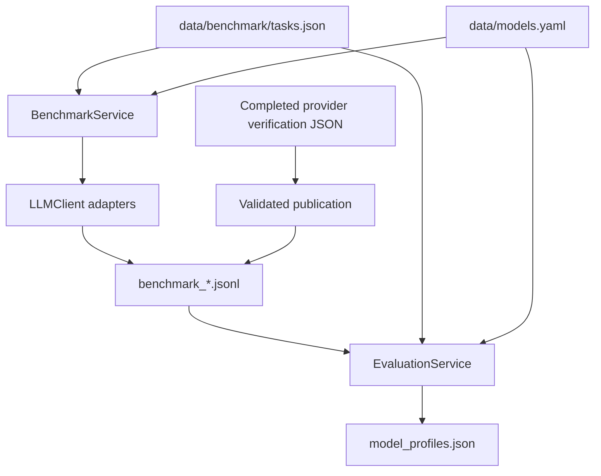
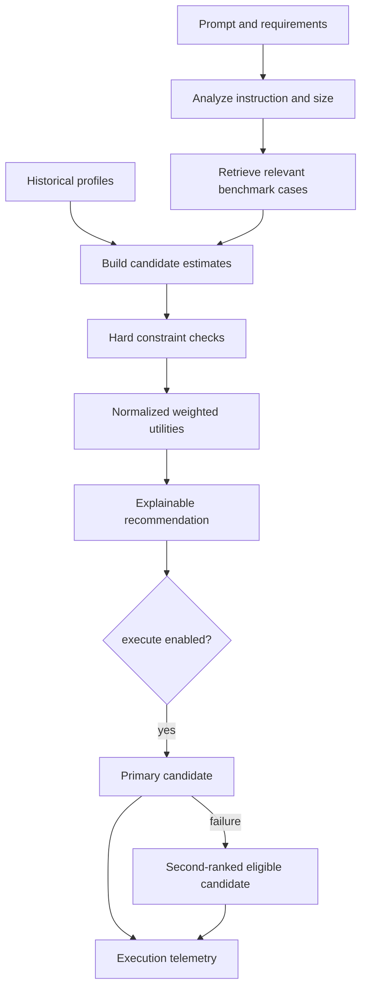

# Architecture

AI FinOps separates provider invocation, offline measurement, prompt assessment,
routing decisions, and presentation. FastAPI and Gradio call the same services.
Gradio connects directly to those services and shares configured storage with the API.

## Components

- `app/llm/interface.py` defines `LLMClient` and the normalized `LLMResponse`.
- `ProviderRouterClient` delegates `ollama/` identifiers to the native httpx adapter
  and other identifiers to LiteLLM.
- `ModelRegistry` loads metadata, enabled flags, capabilities, generation options,
  context windows, and shadow token rates from YAML.
- `ComparisonService` executes candidates concurrently and yields independent progress
  snapshots. FastAPI returns the final snapshot, while Gradio renders updates.
- `BenchmarkService` runs golden tasks and persists execution records.
- `EvaluationService` validates task identity, scores outputs, and atomically replaces
  the persistent profile snapshot.
- `publish_verification` imports completed verification outcomes into the regular
  benchmark workflow using a stable content-derived filename.
- `RouterService` loads profiles and evidence, builds request estimates, invokes the
  pure routing functions, and optionally executes the selected candidate.
- `TelemetryService` appends comparison and routing executions to daily JSONL files.

## Offline measurement

The golden dataset contains four tasks for each supported type. Each record identifies
its task, prompt, model, provider, outcome, token usage, elapsed time, estimated cost,
and timestamp. A raised adapter exception becomes a failed benchmark record.

Evaluation groups records by `(model_id, task_type)`. It computes mean reference
quality, median and interpolated p95 latency, mean estimated cost, reliability, and
sample count. Failed outcomes contribute zero quality and remain in reliability and
latency statistics. Current registry rates can reprice recorded tokens while the
raw logs retain their original contents.

The profile snapshot records scorer version, dataset/pricing hashes, source filenames,
and generation time. Re-evaluation rebuilds the snapshot. Publishing the same exact
verification report again reuses its filename and preserves sample counts.

## Runtime routing

The prompt analyzer uses English instruction rules and inspects the instruction prefix.
Explicit task overrides are preserved and detected mismatches appear in the response.
Lexical TF-IDF/cosine matching operates on benchmark content after stripping instruction
scaffolding and common words.

`CandidateEstimate` holds request-dependent predictions separately from the measured
`ModelProfile`. Cost, context, latency, quality, and reliability checks use the applicable
metric basis. The `task_average` mode uses historical performance metrics and provides
a baseline for comparison.

Stage 1 checks enabled status, task capability, profile availability, context capacity,
quality, cost, latency, and reliability. Stage 2 ranks passing models using normalized
utility and the requested weight preset or custom weights. Exact score ties use model ID.

Execution attempts the highest-ranked model and then the second-ranked eligible model
once if needed. The response retains the original recommendation, successful executor,
all attempt results, fallback status, and summed observed estimated cost.

## Persistence and consistency

- Benchmark files and daily telemetry use JSONL.
- Profiles use a Pydantic-validated JSON snapshot with atomic replacement.
- Source filenames accepted by `/evaluate` are validated benchmark basenames under
  the configured results directory.
- Missing profiles lead to candidate rejection with setup guidance.
- Invalid profile snapshots produce actionable errors. Failed evaluation preserves
  the previous profile snapshot.
- Missing detailed benchmark evidence leads to visible task-prior fallback. Request
  size still contributes to cost/context estimates.

File-based storage targets one local application instance. Coordination across several
processes, retention enforcement, and transactional storage require additional design.
The profile and benchmark files should travel together when moving an experiment.

## Provider failure handling

Comparisons use a configurable wall-clock deadline, including the LiteLLM retry.
Consumers that stop reading streamed snapshots cancel outstanding provider tasks.
Cloud adapters report missing keys, provider errors, and empty answer text as failures.
Native Ollama keeps provider-specific payload normalization inside its adapter.

Observed provider failures and quota exhaustion are returned as execution outcomes.
`GET /health` reports application/registry initialization. A live provider check supplies
separate access evidence.

## Integration boundaries

The current application has local-development CORS settings and file persistence.
An enterprise integration can replace provider adapters and storage behind the existing
contracts, then add authentication, deployment controls, and approved telemetry policy.

The methodology documents estimator behavior and uncertainty in detail.
[Routing methodology](prompt_routing.md)
