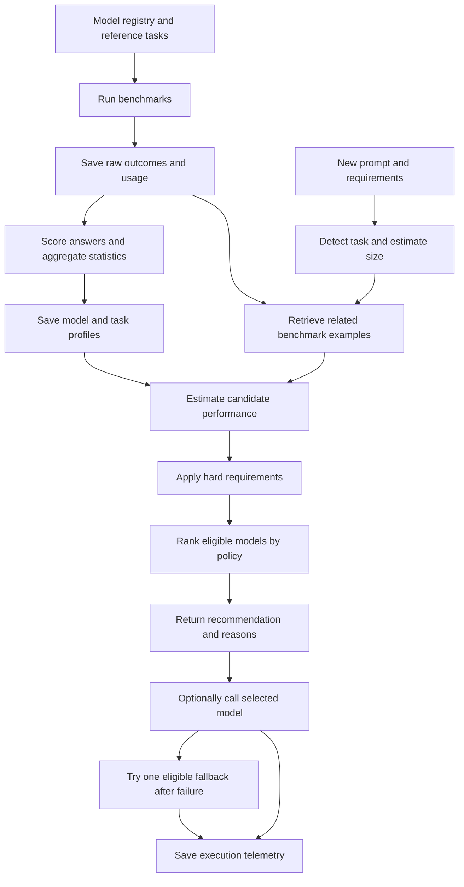

# Project walkthrough

## The problem and the result

An application may use language models to summarize documents, classify reviews,
extract structured information, and answer reasoning questions. Different models can
have different response quality, token costs, response times, and call-success rates.
AI FinOps measures those differences and selects a model under explicit requirements.

For example, a customer-support application might need to classify thousands of
reviews. A suitable model should meet the required quality and response time while
keeping estimated token cost within budget. Another application might place a higher
weight on quality when summarizing a long report.

This repository implements a local internship MVP. It combines a shared provider
interface, benchmark collection, reference scoring, saved model profiles, prompt
analysis, explainable routing, optional execution, and two user interfaces.

## The complete flow



The measurement phase establishes evidence before ordinary routing. A fresh clone
therefore needs benchmark collection and evaluation before Smart Router can select
from measured candidates. Saved measurements also allow recommendations during a
provider outage.

## Interfaces and request contracts

### FastAPI

`app/main.py` creates the application, configures its lifespan, loads the registry,
and initializes shared services. `app/api/routes.py` exposes seven endpoint patterns.

- `GET /health` confirms application and registry initialization.
- `GET /models` lists enabled models.
- `GET /models/{model_id}` returns metadata for one known model.
- `POST /compare` executes selected models and returns their results.
- `POST /evaluate` rebuilds profiles from saved benchmark runs.
- `GET /profiles` reads the saved profile snapshot.
- `POST /route` recommends a model or optionally executes the recommendation.

FastAPI provides a callable backend for future integrations and generates interactive
Swagger documentation at `/docs`. The HTTP comparison response contains the completed
results. The comparison service also supports incremental progress for the Gradio UI.

### Gradio

`app/demo.py` builds three tabs using the same application services as the API.

- **Comparison** sends the same prompt to selected models and displays responses,
  tokens, latency, shadow cost, and failures as results finish.
- **Smart Router** accepts a prompt, task override, routing basis, policy, and
  requirements. It displays candidate estimates, rejection reasons, ranking, and
  optional generated output.
- **Model Profiles** reads saved statistics and re-evaluates existing benchmark files.

Gradio calls the Python services directly. Running the API and UI with the same
configuration gives both access to the same files. This keeps the demonstration
simple while preserving the service boundary used by API clients.

### Pydantic schemas

`app/schemas` defines comparison requests/results, public model metadata, telemetry,
model profiles, prompt analysis, candidate estimates, routing constraints, weights,
and decisions. These contracts validate fields before execution and serialize
consistent JSON responses. For example, negative budgets and whitespace-only
prompts fail request validation.

## Provider access and configuration

### A common model interface

`app/llm/interface.py` defines `LLMClient.generate()` and `LLMResponse`. Each adapter
returns answer text, input/output tokens, total tokens, latency, success, and error.
The rest of the project can use these fields consistently across providers.

`ProviderRouterClient` selects the native Ollama adapter for `ollama/` identifiers
and LiteLLM for the other configured provider identifiers. `OllamaClient` sends an
asynchronous HTTP request to Ollama's chat endpoint. `LiteLLMClient` translates a
common call into the relevant provider API. Both adapters classify empty answer
text as a failed outcome and retain reported usage for that outcome.

This adapter boundary supports adding providers while keeping benchmark, comparison,
and routing logic focused on the common response contract.

### Model registry and settings

`app/llm/registry.py` loads `data/models.yaml`. Each entry contains a stable model ID,
provider identifier, display name, enabled status, supported tasks, context window,
generation options, and input/output shadow rates. The bundled configuration has
six enabled entries across Ollama, Gemini, and Groq. Provider access depends on the
local installation and configured account.

`app/core/config.py` loads environment variables and the project-root `.env`, resolves
data paths, and supplies timeouts. Environment variables take precedence. Logging
and application exception types live in the same `core` package.

Keeping model metadata in YAML makes the experimental assumptions inspectable.
Keeping credentials in environment configuration allows the repository to be shared
without including account keys.

## Measurement, evaluation, and storage

### Comparison and benchmarking serve different purposes

`ComparisonService` executes the user's current prompt against the requested model
set concurrently. It deduplicates model IDs, enforces per-model deadlines, captures
provider failures, preserves result ordering, and cancels outstanding tasks when a
streamed comparison is cancelled. One slow or failed provider can appear alongside
completed results from the others.

`BenchmarkService` instead runs the fixed reference dataset across selected models.
`data/benchmark/tasks.json` contains 16 tasks, with four each for summarization,
classification, extraction, and reasoning. Every task has a known reference answer.
Task-file validation rejects malformed entries and duplicate IDs. Disabled models
produce failed records when explicitly requested, and inference continues for the
remaining enabled candidates.

A shared benchmark makes model performance comparable on the same inputs. A normal
Comparison submission lacks that reference-answer workflow, so its telemetry alone
does not create a quality profile.

### Quality scoring

`app/evaluation/metrics.py` implements deterministic scoring in the range 0 to 1.

- Classification compares the normalized answer with the reference label.
- Extraction parses JSON and compares expected fields and values. Additional fields
  and response wrappers can reduce the score.
- Summarization and reasoning use reference-word coverage and precision, with small
  penalties for supported length constraints.
- Reasoning additionally checks whether reference numbers occur in the output.
- Failed calls contribute zero quality.

For example, `POSITIVE` receives full classification credit against the reference
`POSITIVE`. A successful extraction call can still earn partial credit if it omits
an expected field. Call success and answer quality therefore measure different things.

The scorer is cheap, repeatable, and inspectable. Its vocabulary and numeric checks
provide limited proxies for semantic correctness, so larger evaluations and stronger
rubrics remain future validation work.

### Profiles and telemetry

`EvaluationService` verifies each benchmark record against the exact reference task
ID, type, and prompt. It groups records by model and task type, then computes mean
quality, mean shadow cost, median/p95 latency, call-success fraction, and sample count.
`app/services/statistics.py` supplies the shared latency calculations.

For an illustrative ten-call group with nine successful calls, reliability is 0.9.
The failed observation contributes zero quality and remains part of latency statistics.
One model can therefore have different summarization and extraction profiles.

Evaluation writes `model_profiles.json` using atomic replacement. A failed rebuild
preserves the last completed snapshot. The snapshot includes source filenames,
scorer version, dataset/pricing hashes, and generation time for traceability.

`TelemetryService` appends comparison and routed executions to daily JSONL files.
Benchmark records are saved separately as `benchmark_*.jsonl`. JSONL stores one JSON
record per line, making the small experiment easy to inspect. Generated files stay
in the ignored results directory because they contain environment-specific outcomes
and prompt/response content.

`profile_publication.py` imports completed provider-verification reports into the
normal benchmark workflow. It validates raw outcomes and uses a content-derived
filename so importing the identical report again preserves its sample counts.

## How Smart Router chooses a model

### Prompt analysis

`app/domain/prompt_analysis.py` detects English task cues from the instruction prefix,
estimates prompt tokens, identifies supported output-length hints, and reports
uncertainty. An explicit task choice overrides automatic detection.

For `Summarize in 2 lines: ...`, the analyzer identifies summarization and creates
an output-length hint. Unsupported or ambiguous instructions use a broad reasoning
fallback with a warning. Automatic task detection is implemented with text rules.

### Two routing bases

**Historical task averages** uses the saved model/task quality, mean cost, median
latency, and reliability. Prompt analysis still identifies the task and checks context
capacity. Two summarization prompts with equal settings will usually have the same
performance basis, unless context requirements change eligibility.

**Prompt-aware estimates** additionally uses the actual text to retrieve related
benchmark cases through TF-IDF/cosine lexical matching. The `assess_candidates`
function in `app/services/prompt_assessment_service.py` builds per-model estimates
using each model's own observations. It blends related-case
quality/reliability with the historical task prior, calibrates input-token estimates
from observed usage, estimates output size, and scales latency using token volume
when successful usage evidence exists.

For a cloud-computing summary, cloud-related reference cases can influence the
estimates. An unrelated topic can use the broader task prior. The response exposes
matched task IDs, sample counts, estimate basis, and warnings. Missing detailed
evidence allows a reported fallback to saved task profiles while cost/context still
use the request size.

The measured `ModelProfile` and predicted `CandidateEstimate` have separate response
fields so reviewers can inspect the evidence behind the prediction.

### Hard requirements and weighted preferences

`app/domain/routing.py` first checks enabled status, declared task support, profile
availability, context capacity, minimum quality, maximum cost, maximum latency, and
minimum reliability. A failed requirement excludes the model and produces a reason.
If every candidate fails, the result is `no_candidate` with an explanation.

`app/domain/scoring.py` then converts the eligible models' four performance metrics
to comparable 0-to-1 utilities. Higher quality/reliability and lower cost/latency earn
higher utility. `app/domain/policies.py` supplies the weights for `balanced`,
`cost_first`, `quality_first`, and `latency_first`. Custom API weights can override
the preset. The weighted average determines rank, with model ID resolving ties.

Consider two hypothetical eligible models with equal reliability. Model A has quality
0.80, cost $0.001, and latency 500 ms. Model B has quality 0.90, cost $0.003, and latency
1,500 ms. Balanced weights favor A on these values because its cost and latency
advantages outweigh its quality disadvantage. Quality-first weights favor B. Raising
minimum quality to 0.85 excludes A before either policy ranks candidates.

This order allows a user to express both requirements and preferences. The selected
model can remain the same across different prompts when it continues to rank highest.

### Execution and speed

`RouterService` orchestrates profile loading, assessment, selection, and optional
generation. Recommendation-only routing performs local processing over saved evidence.
Comparison makes fresh provider calls for every selected model, so it includes network
latency and answer-generation time. This explains why recommendation commonly finishes
much faster.

With execution enabled, the router calls the first-ranked candidate. A failure permits
one attempt through the second-ranked eligible model. It returns attempt details,
the executed model, final status, response, and total estimated cost across attempts.
Fresh output quality and elapsed time depend on the actual generation.

## Cost estimates and experiment results

`app/llm/cost.py` calculates shadow USD from token counts and configured rates.

```text
estimated cost = input tokens × input rate / 1,000,000
               + output tokens × output rate / 1,000,000
```

At the configured local Llama rate of $0.06 per million input/output tokens, 1,000 input
and 200 output tokens yield $0.000072. Shadow prices provide a common experimental
cost axis across local and free-tier models. Actual account billing and local machine
cost require their own accounting.

Prompt-aware ranking uses expected output size for expected cost. Its budget check
reserves the maximum allowed output tokens. A fallback can add another candidate
call's cost because the constraint applies per attempt.

`scripts/evaluate_router_kpi.py` compares saved routed outcomes with a fixed-model
baseline. It holds each task out of profile construction before choosing for that task,
then pairs the saved outcomes for the selected model and baseline. The current replay
uses historical task averages. Its report records paired coverage and skipped tasks.

The committed historical nine-task experiment recorded 95.96% lower shadow cost and
108.93% retained reference quality, alongside median latency increasing from about
0.84 seconds to 11.97 seconds. These values describe that experiment's cost/latency
tradeoff. The full report specifies its assumptions and reproduction command.
[Historical KPI report](kpi_report.md)

## Scripts, tests, and project boundaries

- `run_benchmark` collects raw outcomes for chosen models and tasks.
- `verify_providers` exercises configured providers and can publish the measurements.
- `publish_profiles` imports a completed verification report later.
- `verify_ui` checks the three Gradio workflows through HTTP.
- `verify_prompt_routing` checks prompt analysis, mode differences, estimates, and
  optional execution using the prepared demonstration experiment.
- `evaluate_router_kpi` produces the paired historical replay report.

The `tests` directory covers API contracts, adapters, comparison, estimates, scoring,
profiles, publication, constraints, execution fallback, and UI callbacks. Fake adapters
make failures and edge cases repeatable. Live checks provide separate evidence for
the configured provider accounts. `pyproject.toml` declares runtime/development
dependencies, packaging, and test/lint settings. The Dockerfile packages the API.

The design uses modular Python and file storage to keep the internship experiment
inspectable. The English task rules, small dataset, reference-overlap scorer, heuristic
latency estimates, changing provider access, and file-based coordination constrain
its current scope. Production use would require representative independent evaluation,
profile freshness management, durable coordinated storage, and deployment-specific
authentication and telemetry controls.

## Suggested reading and presentation order

Start with this walkthrough, then inspect the demo and API routes. Follow one route
through `RouterService`, prompt analysis, candidate assessment, requirement checks,
ranking, and the provider adapter. Use the saved profile and raw benchmark schema to
explain where the selection evidence comes from.

For a mentor demonstration, show Comparison, Model Profiles, a recommendation with
execution off, one changed requirement, and one executed answer. State the measurement
sample size and describe the recorded KPI tradeoff. The demo guide supplies prompts,
timing, recovery steps, and likely questions.
[Demo guide](demo_guide.md)
